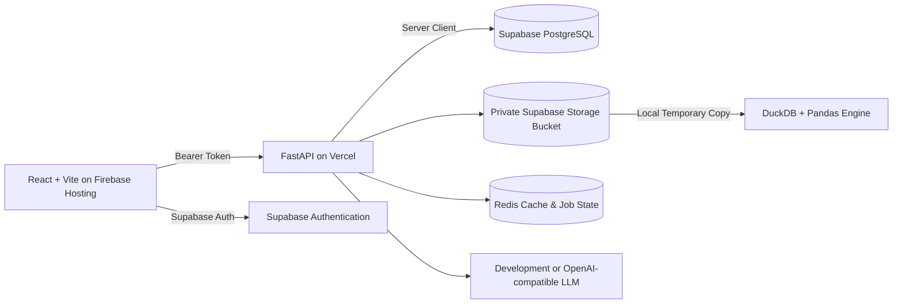
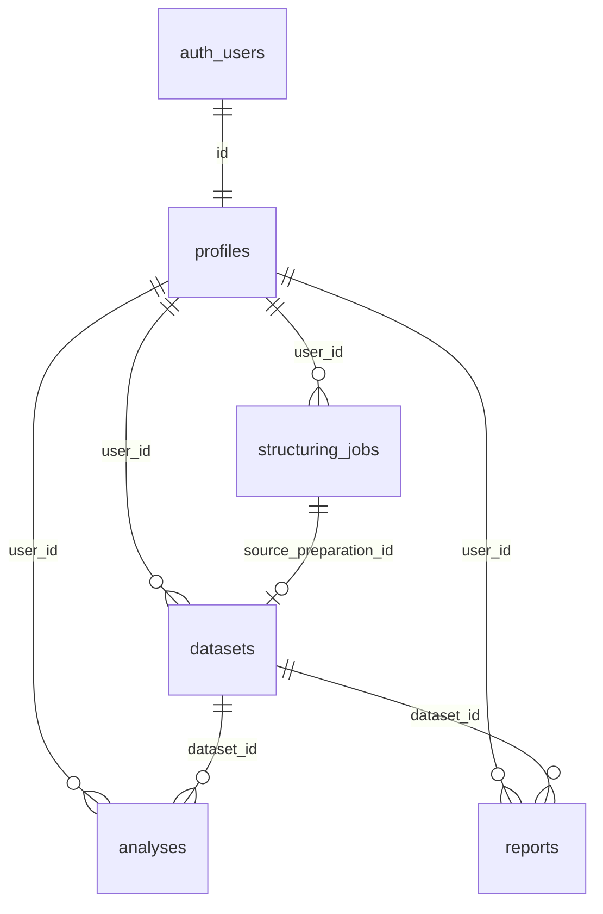

# Signal AI Data Analyst Platform

Signal is a production-oriented analytics workspace for turning raw CSV datasets into inspectable, grounded answers. Users can register accounts, upload private datasets, profile quality, clean raw data via an AI Data Structurer, ask natural-language questions, inspect generated read-only SQL queries, visualize results, forecast trends, detect anomalies, and generate reproducible reports.

## Problem Statement

Analysts often lose time moving between spreadsheets, SQL editors, notebooks, and presentation tools. Signal keeps the entire workflow in one accountable, secure surface: every answer is grounded in an owned dataset, executed via bounded SQL queries, returned as structured rows, and paired with an explicit natural-language explanation.

## Features

- **Supabase Authentication**: Email/password registration, login, session persistence, automatic session restoration, and protected routes.
- **Dataset Management**: CSV upload validation, encoding detection, preview, schema inference, owner isolation, direct-to-storage resumable uploads, and deletion.
- **AI Data Structuring & Preparation**: Comprehensive raw CSV cleaning engine (missing values, duplicates, whitespace, header normalization, data type inference, outlier detection, and clean dataset output).
- **Data Quality & Profiling (EDA)**: Automatic metrics, missing value distributions, category summaries, correlation matrices, and IQR outlier detection.
- **AI Data Analyst**: Natural language to SQL query generation with read-only validation, DuckDB execution, chart configuration, and grounded explanations.
- **Advanced Analytics**: Chronological linear trend forecasting, observational root-cause analysis, and anomaly detection via Isolation Forest.
- **Grounded Reports**: Asynchronous background report generation jobs with Redis status polling, reproducible findings, and downloadable clean CSVs.
- **Production UI**: Responsive layout, dark/light aesthetics, skeleton loaders, toast notifications, error handling, empty states, and accessibility.

## System Architecture

- **Frontend Shell**: React 18 + TypeScript + Vite, styled with Vanilla/Tailwind CSS, deployed to **Firebase Hosting**.
- **Backend API**: FastAPI (Python 3.12) serverless application deployed to **Vercel**.
- **Authentication**: **Supabase Auth** (`@supabase/supabase-js` on frontend, verified Supabase Bearer tokens on backend).
- **Database & Metadata**: **Supabase PostgreSQL** with Row Level Security (RLS) enabled across all tables.
- **File Storage**: Private **Supabase Storage** bucket (`datasets`), user-scoped object paths (`datasets/{user_id}/{dataset_id}/...`).
- **Data Engine**: DuckDB, Pandas, NumPy, and scikit-learn.
- **Cache & Background Jobs**: Redis for query caching, rate limiting, and report job execution.



## Database Schema (Supabase PostgreSQL)

Database tables are defined in `supabase/migrations/0001_application_schema.sql`:



- **`profiles`**: `id` (UUID references `auth.users`), `email`, `display_name`, `role` (`ANALYST`, `ADMIN`, `VIEWER`), `is_active`, `created_at`, `updated_at`.
- **`datasets`**: `id` (UUID), `user_id` (UUID), `name`, `original_filename`, `storage_path`, `file_size`, `mime_type`, `row_count`, `column_count`, `status`, `columns` (JSONB), `source_preparation_id` (UUID), `created_at`, `updated_at`.
- **`analyses`**: `id` (UUID), `user_id` (UUID), `dataset_id` (UUID), `question`, `generated_sql`, `execution_time`, `status`, `result_json` (JSONB), `created_at`, `updated_at`.
- **`reports`**: `id` (UUID), `user_id` (UUID), `dataset_id` (UUID), `title`, `content`, `created_at`, `updated_at`.
- **`structuring_jobs`**: `id` (UUID), `user_id` (UUID), `source_filename`, `source_storage_path`, `output_storage_path`, `file_size`, `status`, `metadata_json` (JSONB), `plan_json` (JSONB), `history_json` (JSONB), `created_at`, `updated_at`.

### User Profile Trigger
An automated PostgreSQL trigger `on_auth_user_created` fires on `auth.users` insert/update to automatically populate `public.profiles` without race conditions.

### Row Level Security (RLS)
All 5 application tables (`profiles`, `datasets`, `analyses`, `reports`, `structuring_jobs`) enforce strict RLS policies:
- Users can only `SELECT`, `INSERT`, `UPDATE`, and `DELETE` rows matching `user_id = auth.uid()`.
- Default role assigned is `ANALYST`. Standard users cannot modify their own role to `ADMIN`.

### Storage Policies
The private bucket `datasets` enforces folder-based RLS:
- Objects must follow path segment rules: `(storage.foldername(name))[2] = (select auth.uid())::text`.
- Users cannot read, upload, modify, or delete storage objects belonging to other users.

## Authentication Flow

1. User registers/logs in via Supabase Auth (`@supabase/supabase-js` client).
2. Upon sign-in, the browser receives a Supabase JWT access token.
3. Every API call includes `Authorization: Bearer <access_token>`.
4. FastAPI backend verifies the token with Supabase Auth, extracts the verified user UUID, and scopes all repository/storage queries to that verified identity.

## Local Development

### 1. Configure Environment
Copy `.env.example` to `.env` and fill in your Supabase configuration:
```powershell
Copy-Item .env.example .env
```

Ensure `.env` contains:
```ini
APP_ENV=development
SUPABASE_URL=https://azfaieuwnhgjbedfeybl.supabase.co
SUPABASE_SECRET_KEY=your-supabase-service-role-key
VITE_API_BASE_URL=http://localhost:8000
VITE_SUPABASE_URL=https://azfaieuwnhgjbedfeybl.supabase.co
VITE_SUPABASE_PUBLISHABLE_KEY=your-supabase-anon-key
REDIS_URL=redis://localhost:6379/0
```

### 2. Start Backend & Redis
```powershell
docker compose up -d redis
pip install -r backend/requirements.txt
uvicorn app.main:app --app-dir backend --reload --port 8000
```

### 3. Start Frontend
```powershell
Set-Location frontend
npm ci
npm run dev
```

Open application in browser at: `http://localhost:5173`
FastAPI API documentation at: `http://localhost:8000/docs`

## Docker Setup

Run the full stack locally using Docker Compose:
```powershell
docker compose up --build
```

- Frontend: `http://localhost:5173`
- Backend: `http://localhost:8000`
- Redis: `localhost:6379`

Validate docker compose syntax:
```powershell
docker compose config -q
```

## Deployment Configuration

### 1. Backend Deployment (Vercel)
- Root directory: `backend`
- Entrypoint: `backend/api/index.py`
- Configuration: `backend/vercel.json`
- Environment Variables in Vercel:
  - `SUPABASE_URL`
  - `SUPABASE_SECRET_KEY`
  - `CORS_ORIGINS` (`https://data-analystics-6557e.web.app`, `https://data-analysis.veerendra.tech`)
  - `REDIS_URL`
  - `LLM_API_KEY` (optional)

### 2. Frontend Deployment (Firebase Hosting)
- Build output: `frontend/dist`
- Configuration: `firebase.json` and `.firebaserc`
- Direct command:
  ```bash
  firebase deploy --only hosting --project data-analystics-6557e --non-interactive
  ```

### 3. GitHub Actions Workflows
- `.github/workflows/ci.yml`: Runs backend compilation, pytest, frontend vitest, linting, and production build checks on every push and PR.
- `.github/workflows/deploy-backend.yml`: Deploys FastAPI backend to Vercel and verifies health endpoints `/health` and `/health/db`.
- `.github/workflows/deploy-frontend.yml`: Runs frontend verification gates and deploys Vite dist output to Firebase Hosting.

## Full Test Suite & Verification Commands

To run all automated local tests and validations:

```powershell
# Backend compilation & tests
.\.venv\Scripts\python -m compileall backend/app backend/api
.\.venv\Scripts\python -m pytest backend/tests -q

# Frontend tests, linting, & production build
Set-Location frontend
node node_modules/vitest/vitest.mjs run
node node_modules/eslint/bin/eslint.js .
node node_modules/typescript/bin/tsc -b ; node node_modules/vite/bin/vite.js build
Set-Location ..

# Docker and Git check
docker compose config -q
git diff --check
```

## Security Audit & Guardrails

- **No Secrets Committed**: All API keys, tokens, and database passwords are stored strictly in environment variables.
- **Service-Role Key Protection**: `SUPABASE_SECRET_KEY` is server-only and is NEVER exposed to the frontend browser context.
- **CORS Hardening**: Strict CORS origin checking without wildcard `*` allowed in production.
- **SQL Injection Prevention**: Generated SQL queries are parsed, validated as read-only (`SELECT` / `WITH`), blocked from reading system tables or files, and restricted to `dataset_data`.
- **File Upload Security**: Filenames are sanitized against path traversal (`../`), MIME types are verified, file sizes are capped at 50 MB, and temporary files are unlinked after processing.
- **Cross-User Data Isolation**: Mandatory cross-user ownership isolation unit tests guarantee User A can never read, modify, preview, or delete User B's datasets or reports.
